<div align="center">

# MonoMELT

**Legacy Monolith → Microservices Transformation Intelligence Platform**

*Upload a monolith. Get a measured, explainable, deployable microservice blueprint.*

<p>
  
  
  
  
  
  
  
  
  
</p>

</div>

---

## Table of contents

1. [Overview](#1-overview)
2. [Product tour](#2-product-tour)
3. [Technology stack](#3-technology-stack)
4. [System architecture](#4-system-architecture)
5. [End-to-end pipeline](#5-end-to-end-pipeline)
6. [The six intelligence agents](#6-the-six-intelligence-agents)
7. [Engine deep dives](#7-engine-deep-dives)
8. [Data model](#8-data-model)
9. [Security model](#9-security-model)
10. [API reference](#10-api-reference)
11. [Frontend](#11-frontend)
12. [Repository layout](#12-repository-layout)
13. [Getting started](#13-getting-started)
14. [Configuration reference](#14-configuration-reference)
15. [Testing](#15-testing)
16. [Deployment notes](#16-deployment-notes)
17. [Status, roadmap and vision](#17-status-roadmap-and-vision)
18. [Troubleshooting](#18-troubleshooting)
19. [License and team](#19-license-and-team)

---

## 1. Overview

### The problem

Many companies run a large, old application built as a single codebase, a monolith. Over time it gets harder to change: one small edit can break something unrelated, the whole thing must be deployed together, and teams step on each other's work. Splitting it into smaller independent services (microservices) is the usual answer.

The split is risky, and it is mostly decided by gut feeling. Teams cut along the wrong lines and end up with services that call each other constantly, share the same data, cost more to run than the monolith did, and have no clear owner or order of migration. Nobody can easily see how the code is really connected, so the decision turns into an argument about opinions instead of evidence.

### What MonoMELT is

MonoMELT is a web platform that takes a monolith (a ZIP upload or a public GitHub repository) and works out how to break it up. It:

1. reads the code and maps how its files depend on each other;
2. suggests where the service boundaries could go, with several options to compare;
3. for the option you choose, produces a migration plan: the order of steps, a cost estimate, which team owns which service, and where data consistency needs care;
4. generates starter files for the new services (Dockerfiles, Kubernetes manifests, API contracts, a draft Terraform setup);
5. writes a short report that a non-engineer can read.

### Why we built it

- **To replace guesswork with evidence.** Boundaries come from the real dependency graph of the code, not from opinion.
- **To cover the whole decision, not just the split.** Where to cut is only part of it; the order of work, the cost, the risk and the ownership matter just as much.
- **To make the result easy to share.** Managers and technical leaders get a plain report, and engineers get files they can start from.
- **To keep people in control.** Every assumption is visible and can be changed, and AI suggestions need a person to approve or reject them.

### Who can use it

| Role | What they use it for |
| :--- | :--- |
| **Software architects** | See how the code is really connected and compare ways to split it |
| **Engineering managers** | Plan the order of the migration and decide which team owns which service |
| **DevOps and SRE engineers** | Get deployment starting points and an estimate of infrastructure cost |
| **CTOs and technical leaders** | Read the cost, timeline and risk summary before committing to a migration |

It suits any team planning a move from a monolith to microservices, and students or teams who want to understand the structure of an unfamiliar codebase.

---

## 2. Product tour

<div align="center">

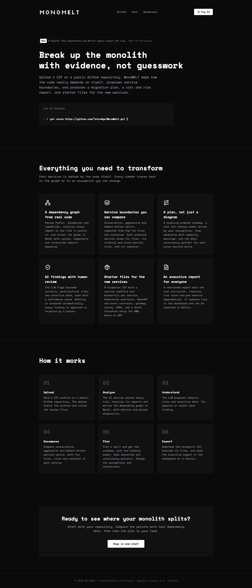

*The landing page: what MonoMELT does, how the workflow runs, and how to start it locally*

</div>

The interface is a dark, terminal-inspired workspace that walks a project through the pipeline.

| | |
| :---: | :---: |
| 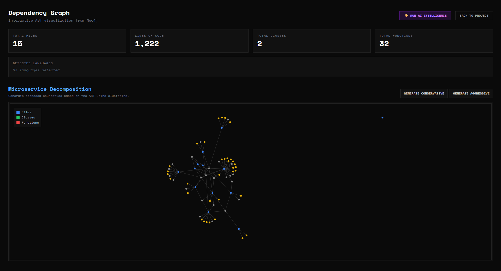 | 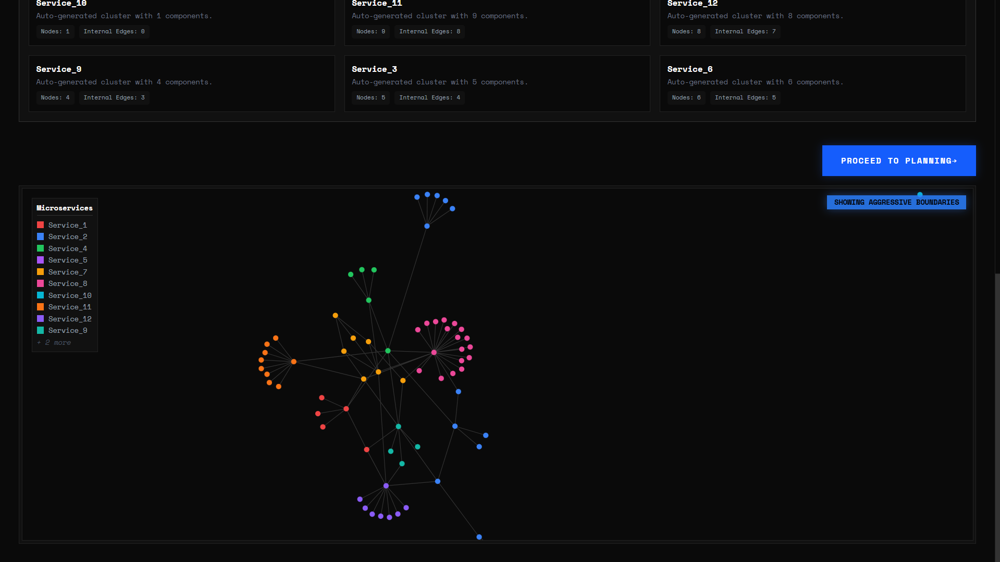 |
| **Analysis:** code metrics and the interactive Neo4j dependency graph | **Decomposition:** proposed services, each in its own colour |
| 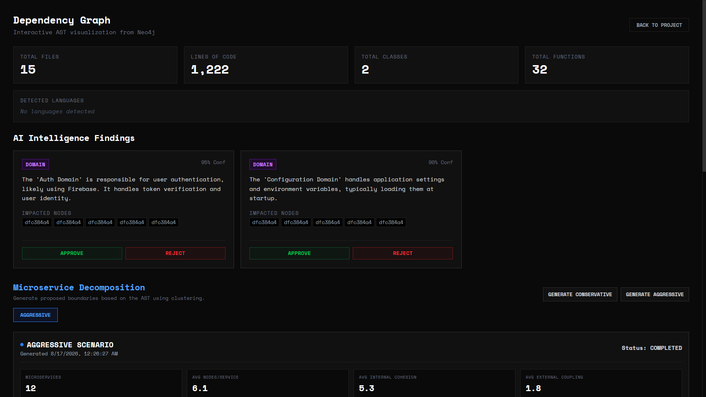 | 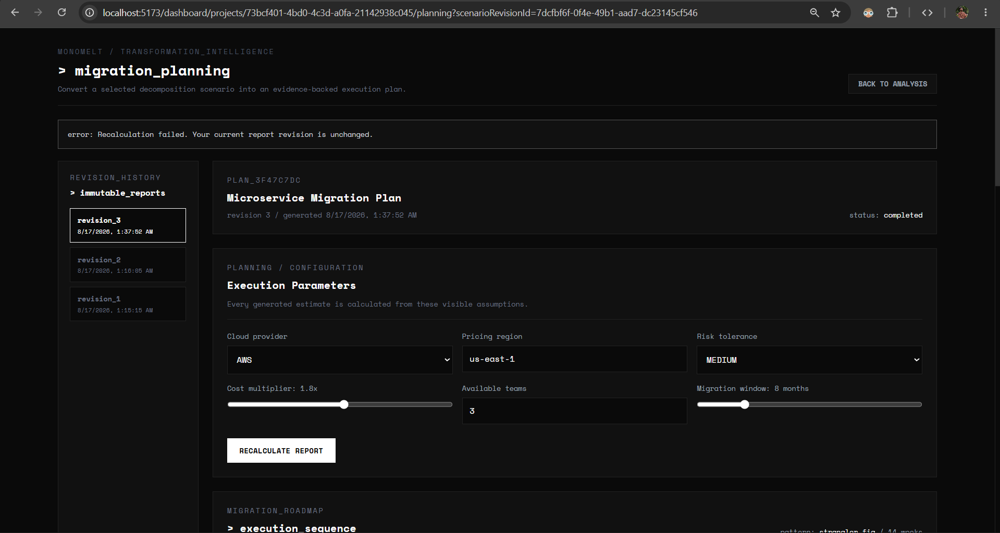 |
| **Intelligence:** LLM findings with confidence and human review | **Planning:** assumptions and immutable revisions |
| 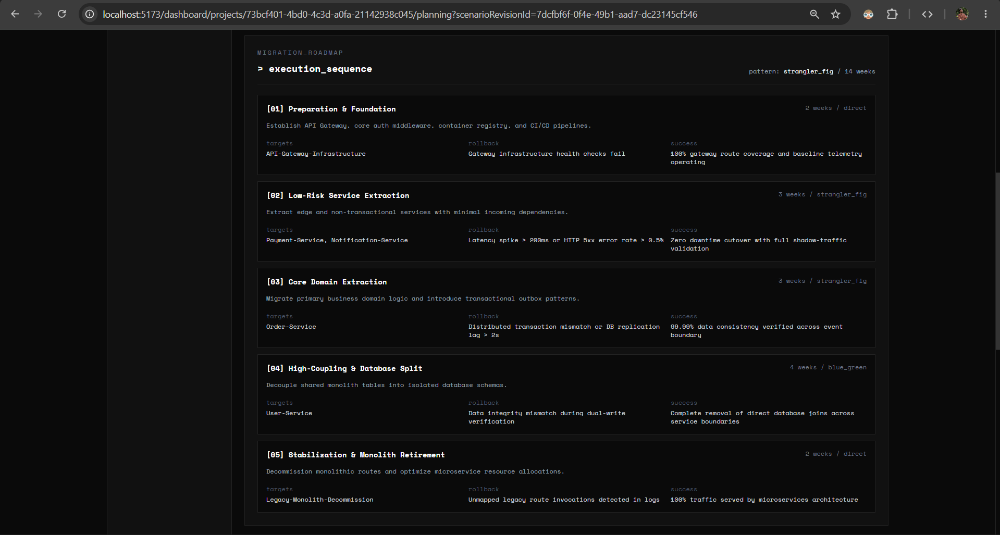 | 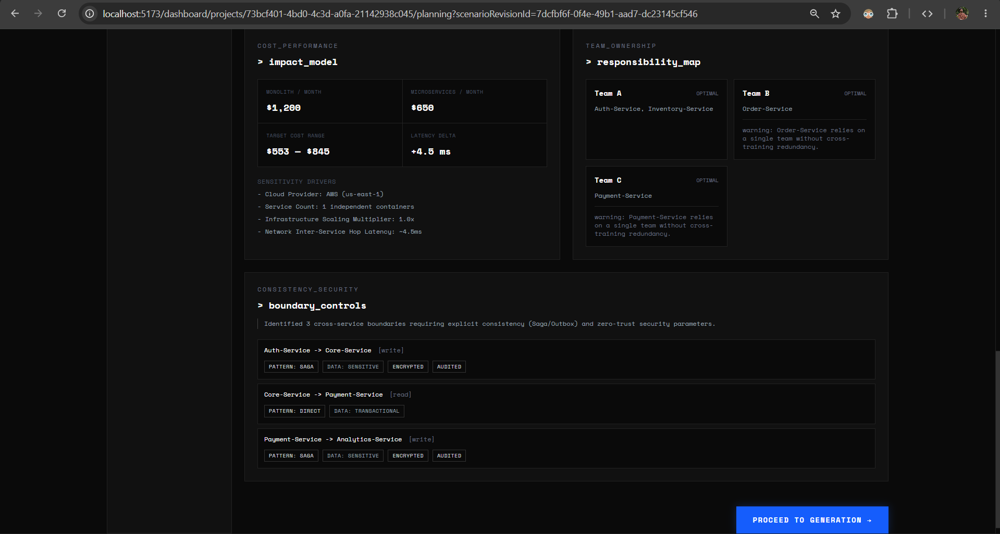 |
| **Roadmap:** staged strangler-fig execution sequence | **Impact:** cost model, team map, consistency controls |

> These screenshots were captured on an earlier build. Service names are now derived from package structure (for example `billing-service`) instead of `Service_N`, roadmap stages are ordered by real coupling, and the export page shows real generated files.

---

## 3. Technology stack

**Frontend**

             

Graph rendering uses `react-force-graph-2d`; icons come from `lucide-react`; smooth scrolling from `lenis`.

**API gateway and worker**

           

**AI service**

          

**Data, auth and storage**

    

**AI providers**

 

**Infrastructure and deployment**

     

**Generated artifacts and tooling**

     

| Layer | Technologies | Role |
| :--- | :--- | :--- |
| Frontend | React 19, TypeScript, Vite, Tailwind v4, TanStack Query, Zustand | Workspace UI, graph and chart visualisation, real-time updates |
| Gateway | Express 5, Supabase JS, BullMQ, Socket.io, Swagger | Authentication, project guard, orchestration, queues, WebSockets, API docs |
| Worker | BullMQ, adm-zip, Supabase JS | Archive validation and extraction, source storage, manifest, analysis trigger |
| AI service | FastAPI, Pydantic, NetworkX, python-louvain, asyncpg | Parsing, graph building, clustering, planning, blueprints, reports |
| Datastores | Supabase Postgres, Neo4j Aura, Redis | Relational state, dependency graph, queues and pub/sub |
| LLM | OpenRouter, Google Gemini | Findings and executive summaries, with automatic fallback |
| Infrastructure | Terraform, AWS (VPC, ALB, CloudFront, S3, ECS Fargate, ElastiCache, ECR, SSM, CloudWatch), GitHub Actions | Repeatable cloud deployment in `ap-south-1`. Terraform owns every AWS resource; a manual workflow ships images and the frontend |

---

## 4. System architecture

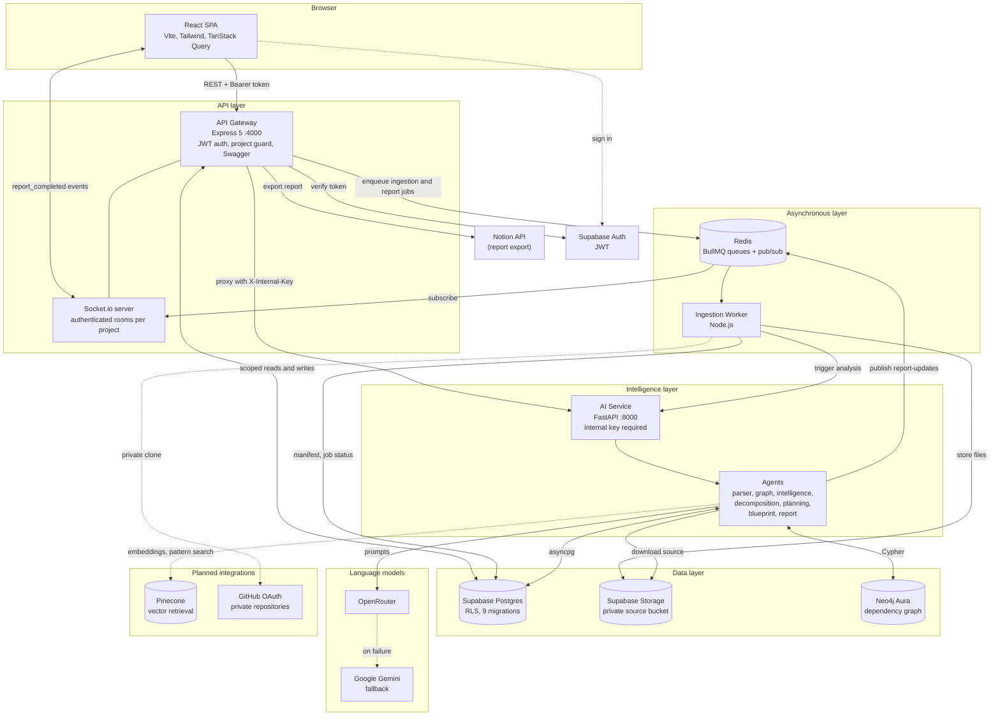

Dashed edges and the **Planned integrations** group are specified but not yet built.

### Service responsibilities

| Service | Port | Owns | Never does |
| :--- | :---: | :--- | :--- |
| **frontend** | 5173 | Rendering, client state, polling and socket subscription | Talk to the AI service or write to protected tables |
| **api-gateway** | 4000 | Auth, ownership checks, request validation, queueing, WebSocket relay, Swagger | Heavy computation |
| **worker** | none | Archive extraction, source storage, manifest, analysis trigger | Serve HTTP |
| **ai-service** | 8000 | Parsing, graph, metrics, LLM calls, clustering, planning, blueprints, reports | Authenticate end users (the gateway does) |
| **redis** | 6380 (host) | BullMQ queues `ingestion` and `report-generation`, pub/sub channel `report-updates` | Store durable state |
| **Pinecone** (planned) | managed | Tenant-filtered embeddings for retrieval and pattern comparison | Act as a source of truth, the graph stays authoritative |
| **Notion API** (external) | api.notion.com | Receives exported reports as Notion pages | Hold user data beyond the export |

### Backend data flow


### AWS deployment

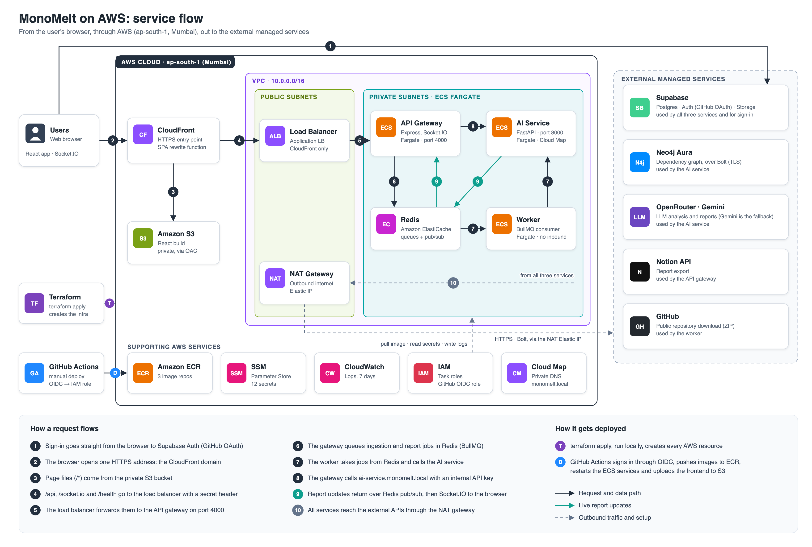

The deployed system has one public address, the CloudFront domain. CloudFront serves the React build from a private S3 bucket and sends `/api`, `/socket.io` and `/health` through an Application Load Balancer to the API gateway. The gateway, AI service, worker and Redis run in private subnets on ECS Fargate and ElastiCache. Supabase, Neo4j Aura, the LLM providers and Notion stay external. Terraform creates all of it, and a manual GitHub Actions workflow builds the images and uploads the frontend. The full runbook is in [deploy/README.md](deploy/README.md).

---

## 5. End-to-end pipeline

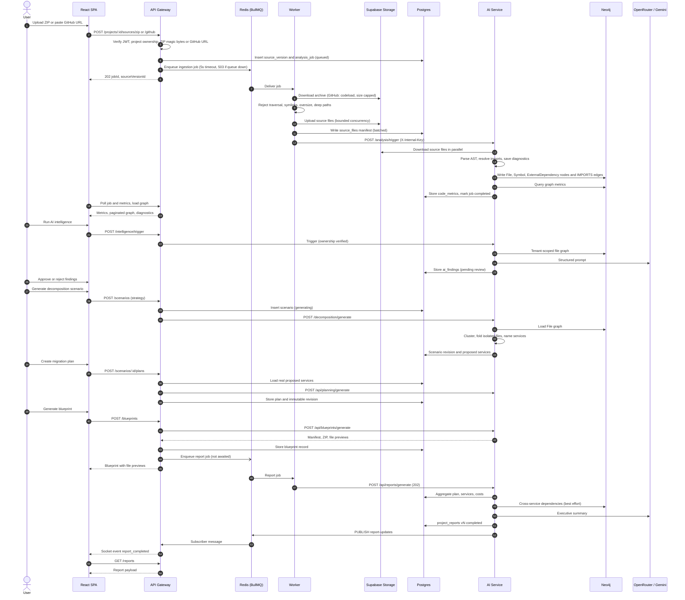

### Job and run lifecycles

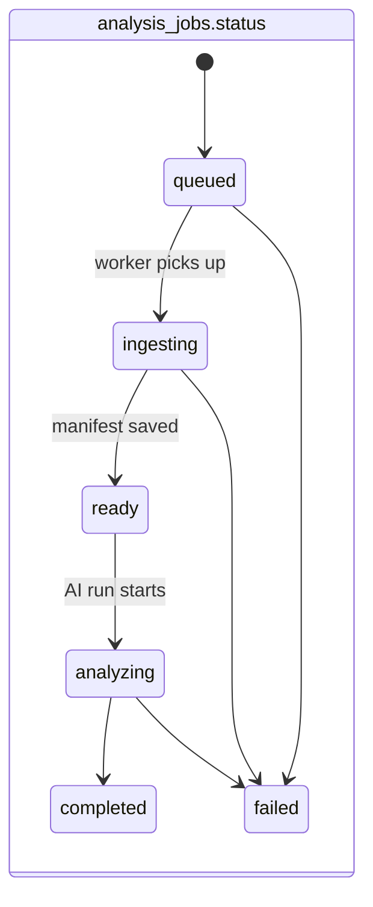

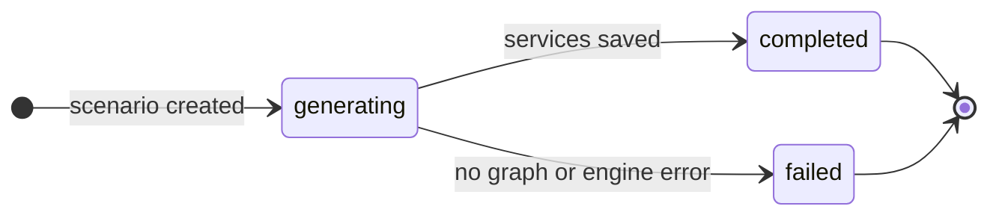

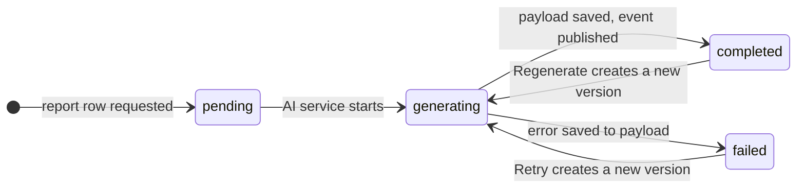

---

## 6. The six intelligence agents


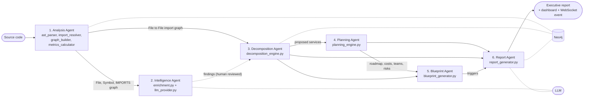

| # | Agent | Module | Input | Output | Storage |
| :-: | :--- | :--- | :--- | :--- | :--- |
| 1 | **Analysis** | `ast_parser.py`, `import_resolver.py`, `graph_builder.py`, `metrics_calculator.py` | Source files | Resolved dependency graph, metrics, diagnostics | Neo4j, `code_metrics`, `parser_diagnostics` |
| 2 | **Intelligence** | `enrichment.py`, `llm_provider.py` | Most-connected files from the graph | Domain, risk and sensitivity findings with confidence | `ai_findings` |
| 3 | **Decomposition** | `decomposition_engine.py` | File import graph | Service boundaries per strategy, cohesion and coupling | `decomposition_scenarios`, `scenario_revisions`, `proposed_services` |
| 4 | **Planning** | `planning_engine.py` | Proposed services and assumptions | Roadmap, consistency matrix, cost and latency model, team map | `migration_plans`, `plan_revisions` |
| 5 | **Blueprint** | `blueprint_generator.py` | Services, plan revision | ZIP of manifests, contracts, scaffolds, Terraform | `blueprints` (package regenerated deterministically) |
| 6 | **Report** | `report_generator.py` | Everything above | Versioned executive report | `project_reports` |

---

## 7. Engine deep dives

### 7.1 Ingestion (worker)

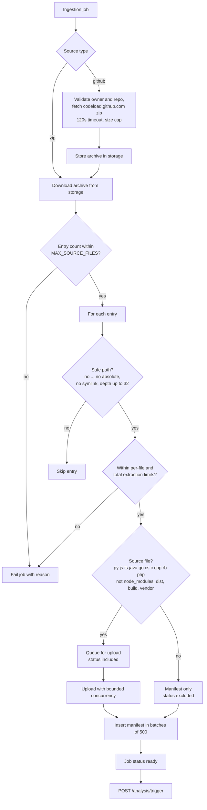

### 7.2 Analysis and import resolution

The parser knows only the module *name* in an import. The resolver maps it onto an uploaded file, which is what turns a pile of isolated files into a graph.

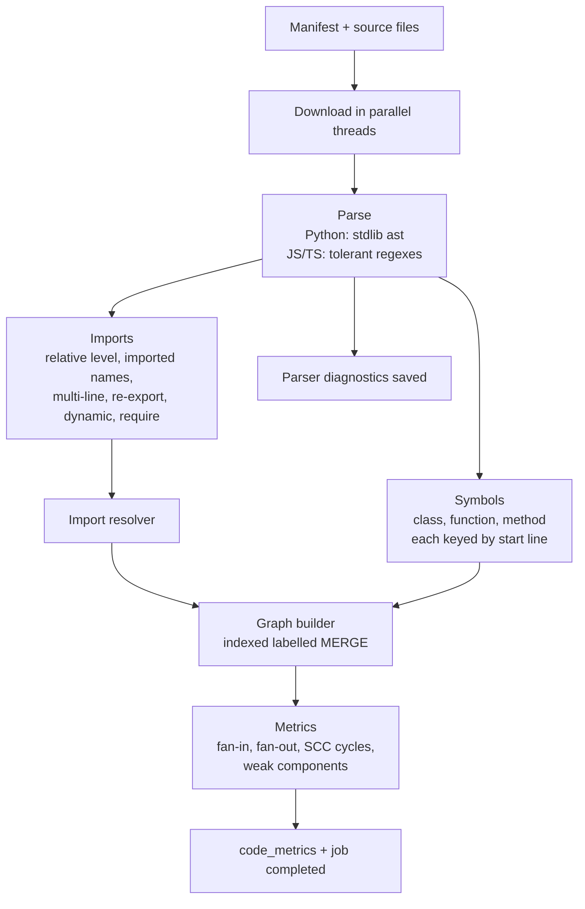

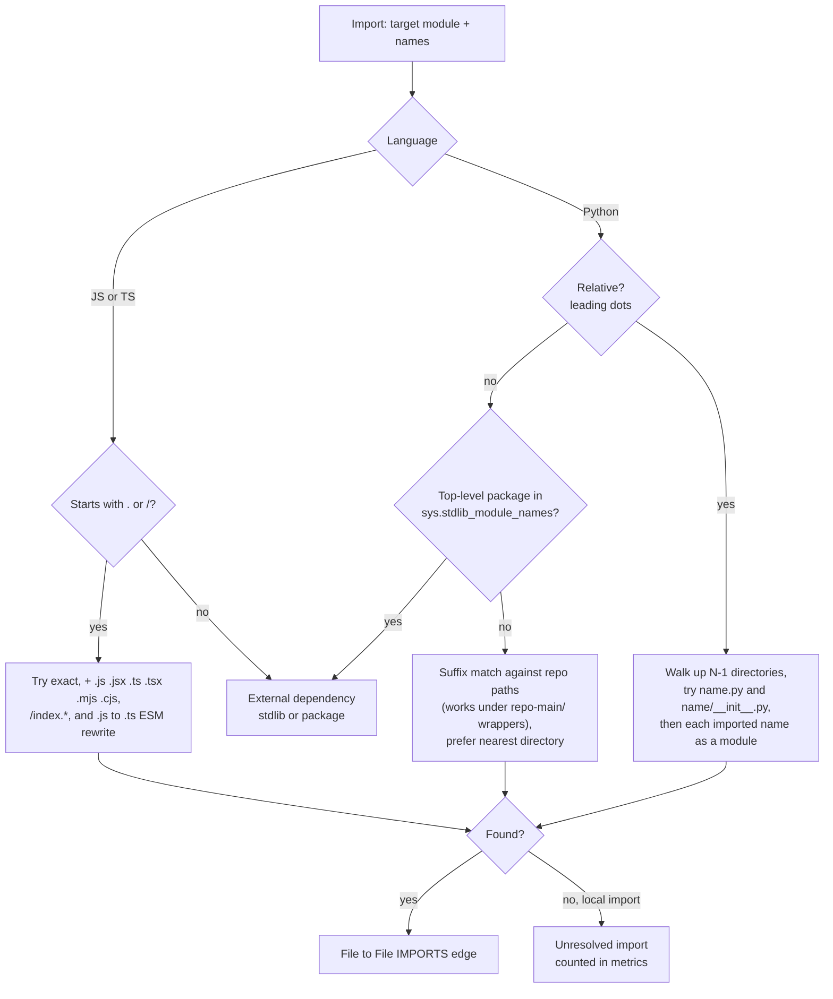

**Graph schema (Neo4j).** Every node carries `owner_id`, `project_id` and `source_version_id`, and every query filters on all three.

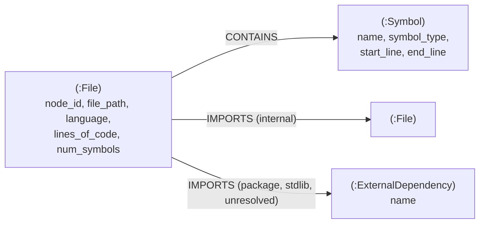

Metric definitions:

| Metric | Definition |
| :--- | :--- |
| Fan-in / fan-out | Files that import a file / files (and packages) it imports, top 10 each |
| Cycle count | Strongly connected components with more than one file, plus self-imports |
| Graph components | Weakly connected components of the file graph |
| Unresolved imports | Local-looking imports that matched no uploaded file |
| Centrality candidates | Files with both high fan-in and fan-out, likely boundary hints |

### 7.3 Decomposition

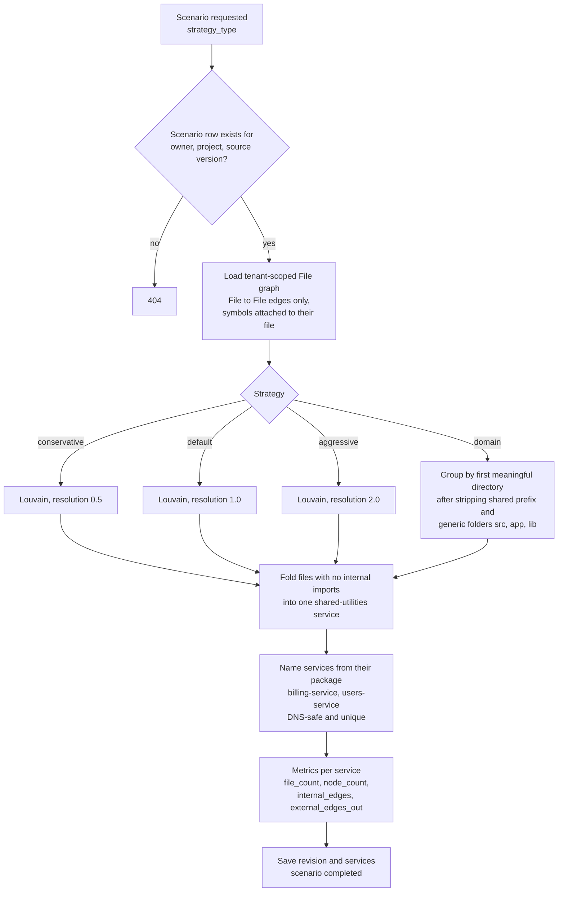

External packages are deliberately excluded from clustering: a package such as `react` is imported everywhere and would otherwise glue unrelated files into one giant service.

### 7.4 Planning

Services are ordered by outgoing cross-service coupling. The least coupled are extracted first and the most coupled last, and each real service appears in exactly one stage.

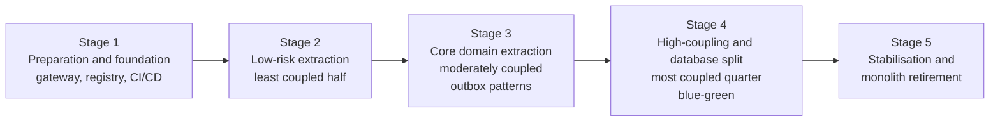

Empty stages are dropped rather than filled with placeholders, and the planner refuses to run without real services (HTTP 422). Each plan stores `assumptions`, `roadmap`, `consistency_security`, `cost_performance` and `team_mapping`. Recalculating with new assumptions appends a new immutable revision.

| Assumption | Range | Effect |
| :--- | :--- | :--- |
| `cloud_provider` | aws, azure, gcp | Pricing factor, Terraform provider |
| `pricing_region` | free text | Region in Terraform and cost drivers |
| `cost_multiplier` | 0.5 to 3.0 | Scales monolith and per-service cost |
| `team_count` | 1 to 20 | Round-robin ownership and capacity warnings |
| `risk_tolerance` | low, medium, high | Selects `modular_monolith` for large service counts at low tolerance |
| `migration_window_months` | 1 to 36 | Target window recorded with the plan |

### 7.5 Blueprint

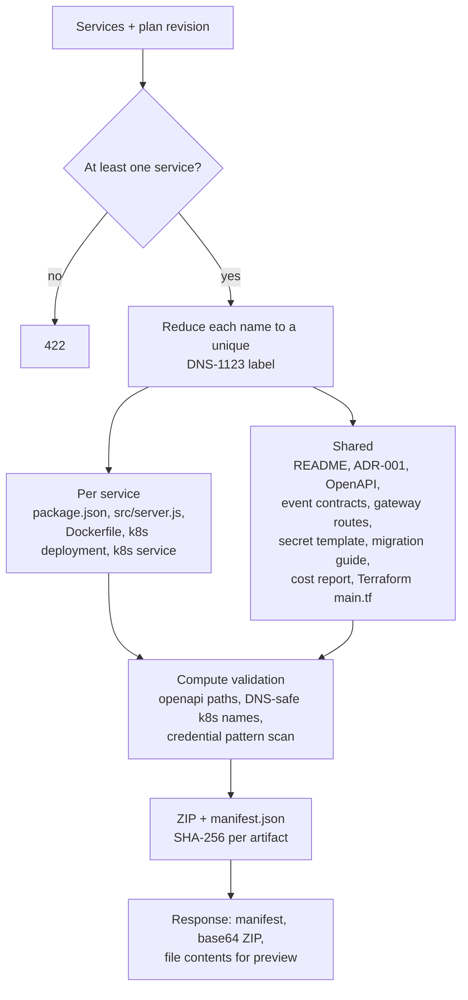

Names are sanitised because they end up in archive paths, Kubernetes object names, hostnames and generated JavaScript. A user-edited name such as `../../x` cannot escape the archive. Packages are regenerated on demand and are deterministic, so the preview and download always match.

### 7.6 Report

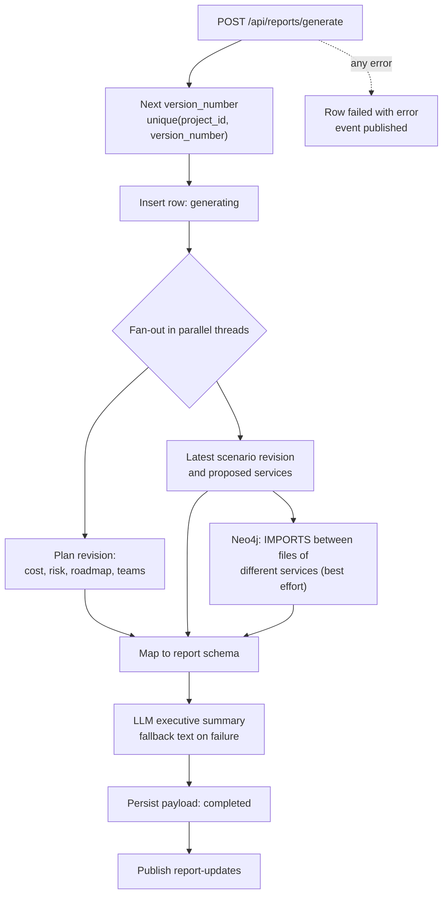

| Report field | Source |
| :--- | :--- |
| `total_services_extracted` | Proposed services in the latest scenario |
| `estimated_timeline_months` | Plan roadmap `total_duration_weeks` converted to months |
| `overall_risk_score` | Share of sensitive or encrypted boundaries: HIGH above 40%, MEDIUM above 15%, otherwise LOW |
| `cost_analysis` | Monolith vs microservice monthly cost, multiplier, range and latency delta |
| `risk_assessment` | Critical paths, consistency flags and mitigations (including single-team warnings) |
| `decomposition_strategy[].dependencies` | IMPORTS edges between the files of different services |

### 7.7 Real-time delivery

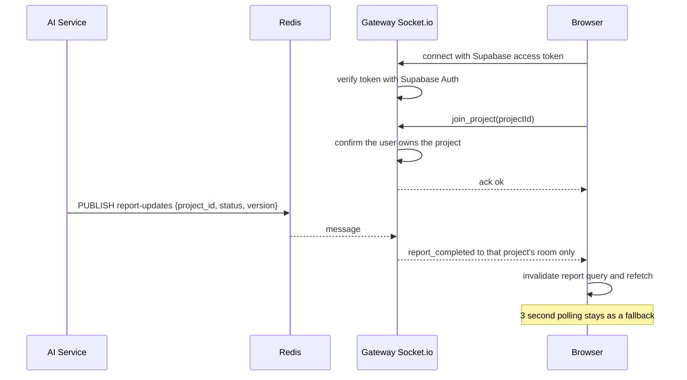

### 7.8 Notion export

The gateway exports the latest completed report to a Notion database. It sends the report straight to the Notion API, and it can use an external Notion MCP server instead when one is configured.

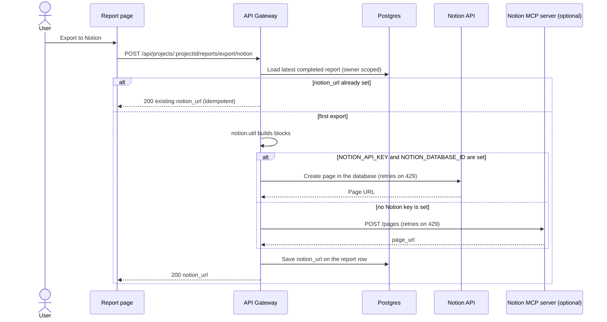

| Report content | Notion block |
| :--- | :--- |
| Title | `heading_1` |
| `executive_summary.business_impact` | `paragraph` |
| Service count and overall risk | `callout` |
| Proposed microservices and dependencies | Heading and bulleted list |
| `cost_analysis.breakdown` | `table` |
| Risk assessment | Headings and lists |
| Interactive dependency graph | Hyperlinked callout back to the MonoMelt analysis page (graphs cannot render in Notion) |

**Setup**

1. Create an internal integration at `notion.so/profile/integrations` and copy its token into `NOTION_API_KEY`.
2. Create a database in Notion with these properties: **Report** (title), **Revision** (text) and **Generated at** (date).
3. Share the database with the integration (**...** → **Connections** → add the integration), then copy the database ID into `NOTION_DATABASE_ID`.

No separate MCP server is needed when the two variables above are set. Without them, the gateway falls back to an MCP proxy at `MCP_NOTION_SERVER_URL` (default `http://localhost:3001/mcp/notion`) that must accept `POST /pages` and return `page_url`.

### 7.9 Semantic retrieval with Pinecone (planned)

Embeddings are meant to *augment* the deterministic graph, never replace it.

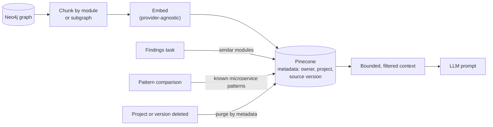

Requirements carried from the phase documents: tenant and project metadata on every vector, filters enforced on every query, deletion when a project or source version is removed, and any external reference corpus seeded only from licensed, reviewed sources.

### 7.10 Interactive boundary editing

The revision API is implemented: a user's edit creates a new immutable `scenario_revision` with its own `proposed_services`. The drag-and-drop interface on top of it is planned (`@hello-pangea/dnd` is already a dependency).

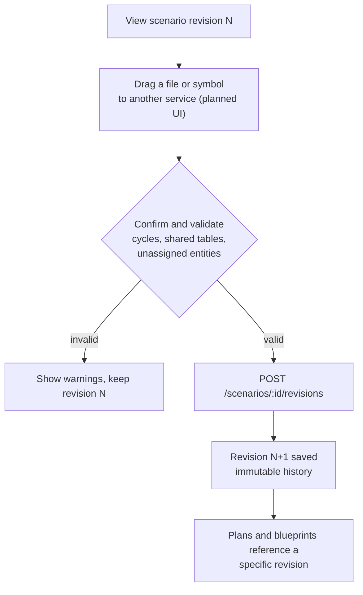

### 7.11 Scenario validations (planned)

Each scenario should be scored and checked before a user commits to it.

| Validation | Purpose |
| :--- | :--- |
| Direct and indirect service cycles | Avoid deployment-order deadlocks |
| Synchronous call-chain depth | Surface latency hot paths |
| Tables written by several proposed services | Flag shared-data risk and distributed-transaction candidates |
| Cross-boundary authentication and PII flows | Highlight security-sensitive seams |
| Unassigned or duplicated entities, low-confidence boundaries | Catch incomplete or unstable splits |
| Strangler seams and dependency leaf services | Recommend safe first extractions |

---

## 8. Data model

All tables live in Supabase Postgres. Migrations `database/migrations/01` to `09` must be applied in order.

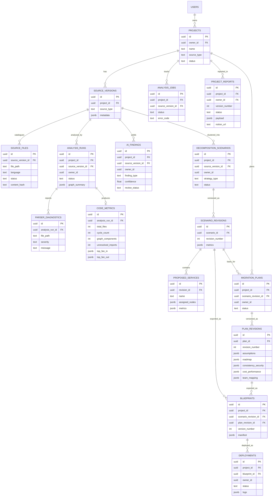

`project_reports` has a `UNIQUE(project_id, version_number)` constraint, so two simultaneous report requests cannot both claim the same version. `profiles` and `audit_events` (migration 01) support user metadata and auditing.

---

## 9. Security model

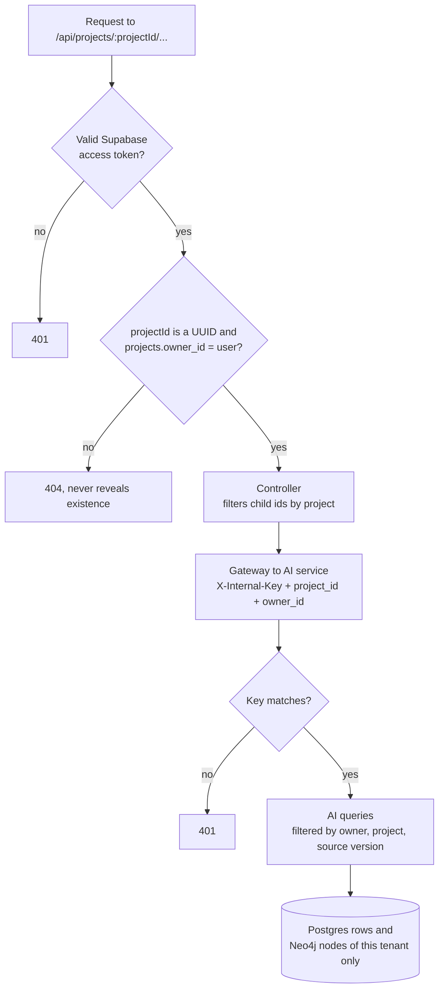

| Control | Where | What it prevents |
| :--- | :--- | :--- |
| Supabase JWT verification | `auth.middleware.js` | Anonymous API access |
| Project ownership guard | `project.middleware.js`, mounted on `/api/projects/:projectId` | Reading or changing another user's project by guessing its id |
| Child-resource checks | Plans, blueprints, decomposition controllers | Passing another project's scenario, plan or revision ids |
| Internal API key | `core/security.py`, gateway and worker clients | Direct, unauthenticated calls to the AI service |
| Restricted CORS | AI service `ALLOWED_ORIGINS`, gateway `FRONTEND_URL` | Cross-origin abuse |
| Tenant-scoped graph | Every Cypher query filters `owner_id`, `project_id`, `source_version_id` | Cross-tenant graph reads |
| Row Level Security | Supabase, migrations 01 to 09 | Direct database access outside the API |
| Authenticated sockets | `socket.js` | Joining another project's real-time room |
| Private source bucket | `storage.service.js` | Public exposure of uploaded code |
| Archive hardening | Worker | Zip slip, symlinks, zip bombs, oversized archives |
| Name sanitisation | Blueprint generator | Path traversal and injection through service names |
| Input validation | GitHub URL and branch regexes, strategy allow-list | Malformed or malicious input |

**Planned hardening**

| Control | Purpose |
| :--- | :--- |
| GitHub OAuth for private repositories with a short-lived, encrypted server-side credential | Private-repo ingestion without exposing tokens |
| Branch resolved to a commit SHA before queueing | Reproducible analysis of an exact revision |
| Gateway rate limiting and per-tenant quotas | Protect LLM spend and shared infrastructure |
| Role-based access and shared workspaces | Team collaboration with least privilege |
| Signed, single-purpose, short-lived export URLs | Private artifact delivery |
| Secret redaction before LLM prompts | Keep credentials out of third-party models |
| Decision audit trail beyond `audit_events` | Traceable approvals and boundary edits |

Notes:

- The service-role key never leaves the backend. The browser only holds the anon key.
- Set `INTERNAL_API_KEY` to the same long random value in the gateway, worker and AI service. When it is empty the AI service logs a warning and accepts unauthenticated calls, which is acceptable for local development only.
- The `openai` storage bucket holds source code. If it already exists as a public bucket, set it to private in the Supabase dashboard.

---

## 10. API reference

All routes except `/health` and `/api-docs` require `Authorization: Bearer <supabase access token>`. Interactive documentation is served at **`/api-docs`** (Swagger UI).

| Area | Method and path | Purpose |
| :--- | :--- | :--- |
| Platform | `GET /health` | Gateway status plus real AI-service and Neo4j state |
| Auth | `GET /api/auth/me` | Current user |
| Projects | `GET /api/projects`, `POST /api/projects`, `GET /api/projects/:id` | List, create, read |
| Sources | `POST /api/projects/:id/sources/zip` | Upload an archive (multipart `file`) |
| | `POST /api/projects/:id/sources/github` | Import `{ repoUrl, branch }` |
| | `GET /api/projects/:id/jobs/:jobId` | Ingestion and analysis job status |
| Analysis | `POST /api/projects/:id/analysis/trigger` | Start analysis for a source version |
| | `GET .../analysis/run/:runId/status` | Run status |
| | `GET .../analysis/:svid/metrics` | Aggregate metrics |
| | `GET .../analysis/:svid/graph?limit=&cursor=` | Paginated graph with real totals |
| | `GET .../analysis/:svid/diagnostics` | Parser warnings and errors |
| Intelligence | `POST .../intelligence/trigger` | Run LLM enrichment |
| | `GET .../intelligence/:svid/findings` | List findings |
| | `POST .../intelligence/findings/:id/review` | Approve, reject or reset |
| Scenarios | `POST .../scenarios` | Create (`conservative`, `aggressive`, `domain`) |
| | `GET .../scenarios`, `GET .../scenarios/:id` | List, read with services |
| | `POST .../scenarios/:id/revisions` | Save manual boundary edits |
| Plans | `POST .../scenarios/:id/plans` | Generate a migration plan |
| | `GET .../plans`, `GET .../plans/:planId` | List, read with revisions |
| | `POST .../plans/:planId/assumptions` | Recalculate as a new revision |
| Blueprints | `POST .../blueprints` | Generate (`{ planId }`) |
| | `GET .../blueprints`, `GET .../blueprints/:id` | List, read |
| | `GET .../blueprints/:id/files` | File contents for preview |
| | `GET .../blueprints/:id/download` | ZIP download |
| Deployments | `POST .../deployments`, `GET .../deployments/:id`, `GET .../deployments/:id/services` | Simulated pipeline and health |
| Reports | `GET .../reports` | Latest report |
| | `POST .../reports/export/notion` | Export the latest report to Notion (returns `notion_url`, idempotent) |
| | `POST .../reports/generate` | Queue a new version (409 while one is generating) |

**Planned endpoints**

| Method and path | Purpose |
| :--- | :--- |
| `POST .../scenarios` with `strategy_type: "team"` | Team-driven decomposition |
| `GET .../scenarios/:id/validations` | Scenario validation results |
| `GET .../blueprints/:id/signed-url` | Short-lived private download URL |
| `POST .../jobs/:jobId/cancel` | Cancel a running ingestion or analysis job |
| `GET .../graph/search?q=` | Search and filter large graphs |

**WebSocket events.** Connect to the gateway with `auth: { token }`, emit `join_project(projectId)` and listen for `report_completed`.

**AI service routes** (internal, require `X-Internal-Key`): `POST /analysis/trigger`, `GET /analysis/run/:id/status`, `GET /analysis/:svid/{metrics,graph,diagnostics}`, `POST /intelligence/trigger`, `GET /intelligence/:svid/findings`, `POST /decomposition/generate`, `POST /api/planning/{generate,recalculate}`, `POST /api/blueprints/generate`, `POST /api/reports/generate`, and the public `GET /health`.

**Error shape.** Gateway errors are `{ "success": false, "message": "..." }`. Queue outages return `503`, validation failures `400`, foreign or missing resources `404`.

---

## 11. Frontend

```mermaid
flowchart LR
    L["/ Landing"] --> LG["/login"]
    LG --> CB["/auth/callback"]
    CB --> D["/dashboard<br/>upload, recent workspaces,<br/>service status"]
    D --> AN["/dashboard/projects/:id/analysis<br/>metrics, graph, findings,<br/>decomposition"]
    AN --> TW["/dashboard/projects/:id/twin<br/>simulated pipeline, stage<br/>and node details"]
    AN --> PL["/dashboard/projects/:id/planning<br/>assumptions, roadmap, cost,<br/>teams, consistency"]
    PL --> EX["/dashboard/projects/:id/export<br/>file preview, download"]
    EX --> DP["/dashboard/projects/:id/deployment<br/>pipeline simulation, services"]
    EX --> RP["/dashboard/projects/:id/report<br/>executive summary, services,<br/>costs, risk matrix"]
```

All `/dashboard` routes sit behind `ProtectedRoute`.

The **Digital Twin** page (`TwinPage.tsx`) shows the seven pipeline stages (ingestion, Redis queue, worker, AST parser, Neo4j, decomposition, export). It loads the project's real values from the API (file and symbol counts, graph size, parser issues, the latest decomposition and its cohesion, blueprint count and Notion state) and can replay the pipeline stage by stage with run, pause, step and reset. The replay itself is a simulation that runs in the browser; the values it shows are real.

| Concern | Approach |
| :--- | :--- |
| Server state | TanStack Query (report polling every 3s while pending or generating) |
| Auth state | Zustand store over Supabase Auth; the axios interceptor attaches the access token |
| Real time | `useReportSocket` joins the project room and invalidates the report query on `report_completed` |
| Errors | `getErrorMessage` shows the server's message instead of "status code 500" |
| Graph | `react-force-graph-2d`; links to nodes outside the loaded page are dropped, nodes are coloured by service or symbol type |
| Structure | `pages/` aggregate, `components/<feature>/` render, `features/<area>/*.api.ts` call the API |

---

## 12. Repository layout

```text
MonoMelt/
├── frontend/                 React 19 + TypeScript + Vite + Tailwind v4
│   └── src/{pages,components,features,hooks,lib,stores}
├── api-gateway/              Express 5 (flat layout, feature.type.js naming)
│   ├── routes/ controllers/ services/ middlewares/ config/ docs/ utils/ tests/
│   ├── server.js             entry point
│   └── socket.js             authenticated Socket.io + Redis subscriber
├── worker/                   BullMQ ingestion and report-trigger worker
├── ai-service/               FastAPI
│   ├── api/routes/           thin routers
│   ├── services/             parser, resolver, graph, metrics, engines, LLM, realtime
│   ├── db/                   neo4j_client.py, pg_client.py, pinecone_client.py (reserved)
│   ├── models/               Pydantic schemas and domain classes
│   ├── core/                 settings and internal-key security
│   └── scripts/              offline tests and diagnostics
├── database/migrations/      01 to 09 SQL migrations
├── e2e/                      end-to-end test harness
├── deploy/                   AWS deployment: deploy/terraform (infrastructure) and deploy/README.md (runbook)
├── .github/workflows/        deploy.yml, manual build, ECS rollout and frontend upload
├── docs/                     original PRD, TRD and phase documents
├── phase-v2/                 Report Agent specification (phases 1 to 6)
├── Output/                   sample generated blueprint
├── Images/                   screenshots and diagrams used in this README
├── docker-compose.yml
├── CLAUDE.md                 contributor and AI-agent conventions
└── .agents/                  architecture rules and skills
```

---

## 13. Getting started

### Prerequisites

| Tool | Version | Notes |
| :--- | :--- | :--- |
| Node.js | 22 recommended (18+) | Gateway, worker, frontend |
| uv | 0.12 or newer | Python package and version manager for the AI service (it installs Python 3.12 for you) |
| Docker | any recent | Only to run Redis locally |
| Terraform | 1.9 or newer | Only to deploy to AWS (section 16) |
| AWS CLI | v2 | Only to deploy to AWS (section 16) |
| Supabase project | n/a | Postgres, Auth and Storage |
| Neo4j Aura (or Neo4j 5) | n/a | `neo4j+s://` or `bolt://` URI |
| LLM key | n/a | OpenRouter and/or Gemini |

### 1. Clone

```bash
git clone https://github.com/Tetra4ge/MonoMelt.git
cd MonoMelt
```

### 2. Database

Run the files in `database/migrations/` **in numeric order** (`01` to `09`) in the Supabase SQL editor. Create a Storage bucket named `openai` and keep it **private**.

### 3. Redis

Redis backs the job queues and the real-time channel. Locally, run it on host port **6380**, which is what the `.env` templates use:

```bash
docker run -d --name monomelt-redis -p 6380:6379 redis:7-alpine
docker exec monomelt-redis redis-cli ping    # PONG
```

Any managed Redis (for example Upstash) works too: set `REDIS_URL` in the gateway, worker and AI service.

### 4. Environment files

Copy each template and fill it in (see [Configuration reference](#14-configuration-reference)):

```bash
cp frontend/.env.example    frontend/.env
cp api-gateway/.env.example api-gateway/.env
cp worker/.env.example      worker/.env
cp ai-service/.env.example  ai-service/.env
```

Use the **same** `INTERNAL_API_KEY` in `api-gateway`, `worker` and `ai-service`, and the same Redis in all three.

### 5. Run the services

Open four terminals:

```bash
# AI service  ->  http://localhost:8000   (docs at /docs)
cd ai-service
uv sync                                   # first time, and after dependency changes
uv run uvicorn main:app --reload --port 8000

# API gateway  ->  http://localhost:4000   (Swagger at /api-docs)
cd api-gateway && npm install && npm run dev

# Worker
cd worker && npm install && npm run dev

# Frontend  ->  http://localhost:5173
cd frontend && npm install && npm run dev
```

`docker-compose.yml` can also start the stack, but it is optional; the commands above are the supported development path. With Docker, `docker compose up` starts the AI service with `--reload` (from `docker-compose.override.yml`); the production image runs without it.

### 6. Verify

```bash
curl http://localhost:4000/health
# {"success":true,"service":"api-gateway","status":"up",
#  "services":{"ai-service":"up","neo4j":"connected"}, ...}
```

Then sign in, create a workspace, upload a ZIP or paste a public GitHub URL, and follow the pipeline from analysis through the report.

---

## 14. Configuration reference

**`api-gateway/.env`**

| Variable | Required | Description |
| :--- | :---: | :--- |
| `PORT` | | Default `4000` |
| `FRONTEND_URL` | | Allowed browser origin(s), comma separated |
| `SUPABASE_URL`, `SUPABASE_JWT_SECRET`, `SUPABASE_SERVICE_ROLE_KEY`, `DATABASE_URL` | yes | Supabase connection |
| `REDIS_URL` | yes | BullMQ and pub/sub |
| `AI_SERVICE_URL` or `AI_SERVICE_DEV_URL` / `AI_SERVICE_PRO_URL` | | AI service base URL |
| `INTERNAL_API_KEY` | prod | Shared secret sent as `X-Internal-Key` |
| `MAX_UPLOAD_BYTES` | | ZIP upload cap, default 50 MB |
| `QUEUE_TIMEOUT_MS` | | Queue enqueue timeout, default 5000 |

**`worker/.env`**

| Variable | Description |
| :--- | :--- |
| `SUPABASE_URL`, `SUPABASE_SERVICE_ROLE_KEY` | Supabase connection |
| `REDIS_URL` | Same Redis as the gateway |
| `AI_SERVICE_URL`, `INTERNAL_API_KEY` | AI service URL and shared secret |
| `MAX_SOURCE_FILES` (10000), `MAX_EXTRACTED_BYTES` (200 MB), `MAX_SOURCE_FILE_BYTES` (5 MB) | Extraction limits |
| `MAX_GITHUB_ZIP_BYTES` (100 MB), `UPLOAD_CONCURRENCY` (8) | GitHub download cap, parallel uploads |

**`ai-service/.env`**

| Variable | Description |
| :--- | :--- |
| `SUPABASE_URL`, `SUPABASE_SERVICE_ROLE_KEY`, `DATABASE_URL` | Supabase connection |
| `NEO4J_URI`, `NEO4J_USERNAME`, `NEO4J_PASSWORD`, `NEO4J_DATABASE` | Graph database |
| `OPENROUTER_API_KEY`, `GEMINI_API_KEY` | Primary and fallback LLM |
| `REDIS_URL` | Publishes `report-updates` |
| `INTERNAL_API_KEY` | Required on every request when set |
| `ALLOWED_ORIGINS` | CORS origins, default `http://localhost:4000` |
| `PINECONE_API_KEY`, `PINECONE_ENVIRONMENT` | Reserved, currently unused |

**`frontend/.env`**

| Variable | Description |
| :--- | :--- |
| `VITE_API_DEV_URL` / `VITE_API_PRO_URL` / `VITE_API_URL` | Gateway URL |
| `VITE_WS_URL` | Gateway WebSocket URL |
| `VITE_SUPABASE_URL`, `VITE_SUPABASE_ANON_KEY` | Public Supabase settings |
| `VITE_MODE` | `development` or `production` |

**Planned and optional variables**

| Variable | Service | Purpose |
| :--- | :--- | :--- |
| `NOTION_API_KEY`, `NOTION_DATABASE_ID` | api-gateway | Notion export (implemented, see section 7.8) |
| `MCP_NOTION_SERVER_URL` | api-gateway | Fallback used only when `NOTION_API_KEY` or `NOTION_DATABASE_ID` is missing |
| `GITHUB_CLIENT_ID`, `GITHUB_CLIENT_SECRET` | api-gateway | GitHub OAuth for private repositories |
| `PINECONE_API_KEY`, `PINECONE_ENVIRONMENT` | ai-service | Vector retrieval (already templated) |

**Deployment settings (AWS)**

| Where | Names | Purpose |
| :--- | :--- | :--- |
| SSM Parameter Store, `/monomelt/*` (SecureString), region `ap-south-1` | `supabase-url`, `supabase-jwt-secret`, `supabase-service-role-key`, `database-url`, `neo4j-uri`, `neo4j-username`, `neo4j-password`, `openrouter-api-key`, `gemini-api-key`, `internal-api-key`, `notion-api-key`, `notion-database-id` | Read by ECS at task start and injected into the containers |
| GitHub repository variables | `AWS_DEPLOY_ROLE_ARN`, `AWS_REGION` | Let the deploy workflow assume its OIDC role |
| GitHub repository variables | `VITE_SUPABASE_URL`, `VITE_SUPABASE_ANON_KEY` | Baked into the frontend build |

Terraform sets `FRONTEND_URL`, `ALLOWED_ORIGINS`, `AI_SERVICE_URL`, `REDIS_URL` and `NEO4J_DATABASE` in the task definitions, and the deploy workflow sets the frontend API and WebSocket URLs at build time. No deployed URL needs to be edited by hand.

> Never commit `.env` files. They are git-ignored.

**LLM policy.** OpenRouter is the primary provider and Google Gemini is the automatic fallback. Direct OpenAI keys are not used; the `openai` package is only the OpenRouter-compatible client.

---

## 15. Testing

| Suite | Command | Needs services | Covers |
| :--- | :--- | :---: | :--- |
| Gateway unit tests | `cd api-gateway && npm test` | no | Project guard, GitHub URL validation, WebSocket authentication and room access |
| Import resolution | `cd ai-service && uv run python scripts/test_import_resolution.py` | no | Python and JS resolution, multi-line imports, duplicate symbol fix |
| Decomposition | `uv run python scripts/test_decomposition_engine.py` | no | All four strategies, isolated-file folding, naming, full file coverage |
| Planning | `uv run python scripts/test_planning_engine.py` | no | No invented services, coupling order, single-service case |
| Blueprint | `uv run python scripts/test_blueprint_generator.py` | no | Name sanitisation, Terraform per cloud, validation, previews |
| Frontend | `cd frontend && npx tsc -p tsconfig.app.json --noEmit && npm run lint && npm run build` | no | Types, lint, production build |
| Live GitHub flow (API) | `E2E_USER_EMAIL=you@example.com node e2e/github-flow.js` | yes | A real repository through every stage: import, worker, analysis, intelligence, 3 strategies, plan, blueprint, deployment, report, websocket (77 checks) |
| UI smoke (browser) | `cd e2e && npm install && npx playwright install chromium && E2E_USER_EMAIL=you@example.com node ui-smoke.js` | yes | Every page in headless Chromium, including the Digital Twin: content rendered, values match the database, controls work, no console errors, no failed API calls, screenshots (108 checks) |
| Synthetic end to end | `node e2e/run.js` | yes | Fixture repository plus cross-tenant and authentication checks |

The other files in `ai-service/scripts/` (`check_*.py`, `db_*.py`, `test_engine.py` and so on) are diagnostics that run against live databases.

### Test evidence

The live flow imported [`Rahul-8283/chatverse-ai`](https://github.com/Rahul-8283/chatverse-ai) (26 TypeScript files, 3,759 lines) and followed it to the final report in about 90 seconds. These are the pages from the UI run; the same pages from before the fixes are in `Images/testing/before-fixes/`.

| | |
| :---: | :---: |
| 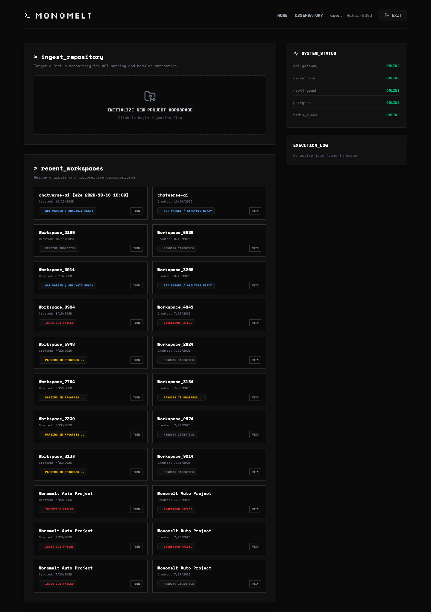 | 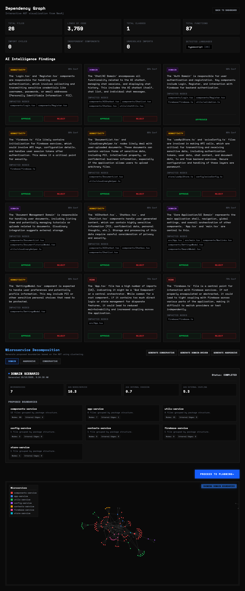 |
| **Dashboard:** five dependencies ONLINE | **Analysis:** metrics, AI findings, scenarios, graph |
| 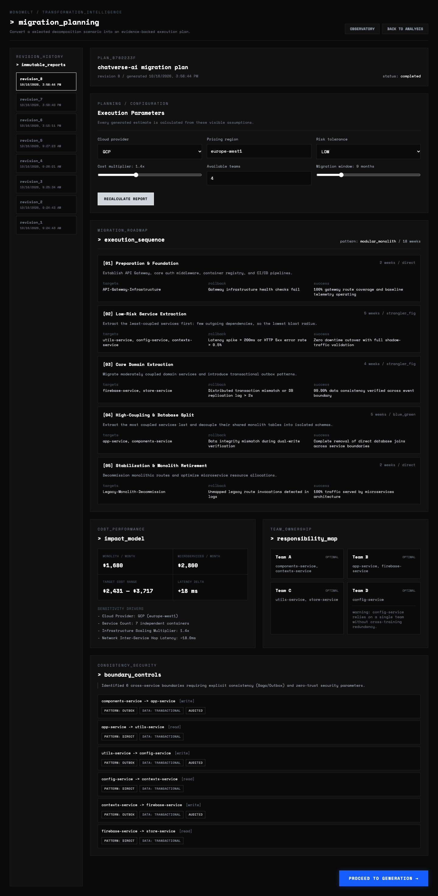 | 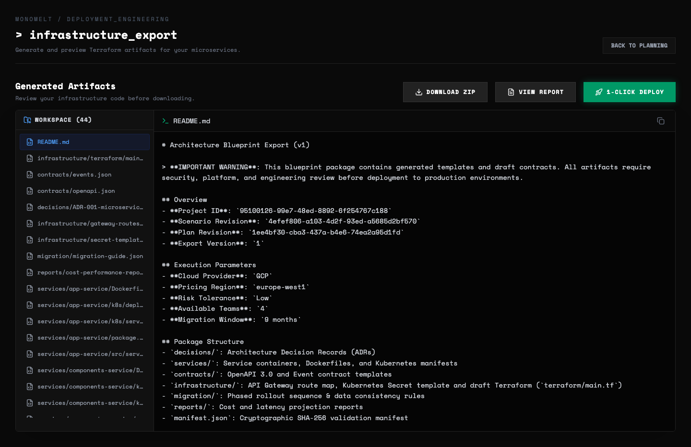 |
| **Planning:** coupling-ordered roadmap, cost, teams | **Export:** 44 generated files, Terraform preview |
| 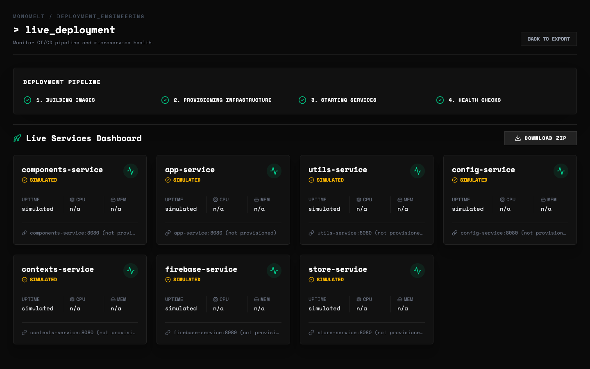 | 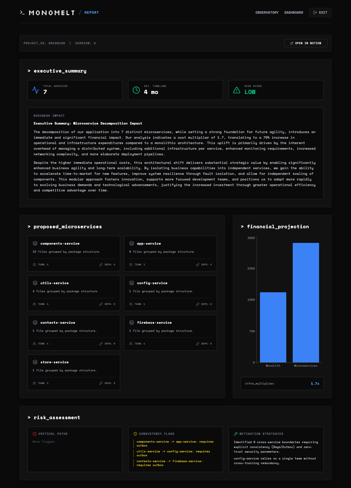 |
| **Deployment:** the project's services, labelled Simulated | **Report:** summary, services, cost chart, risks |

<div align="center">

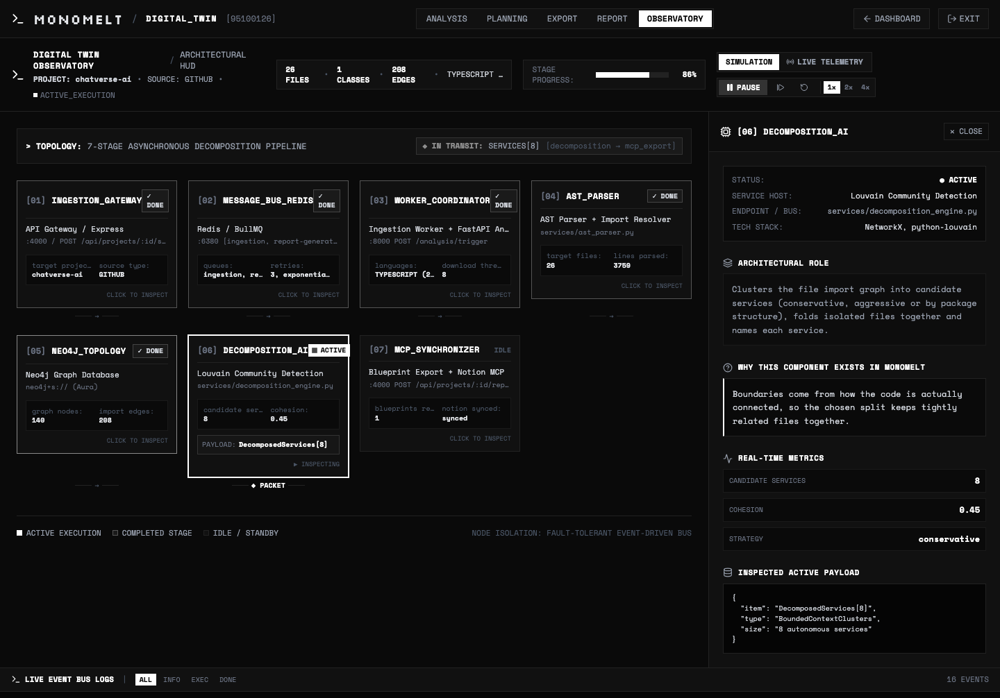

**Digital Twin:** the seven pipeline stages with the project's real values (26 files, 140 graph nodes, 208 edges, 8 candidate services, 1 blueprint), mid-run with the stage detail drawer open

</div>

### End-to-end test

`e2e/run.js` drives the real API: upload, worker ingestion, analysis, intelligence, three decomposition strategies, planning and recalculation, blueprint, deployment, report, report regeneration and WebSocket delivery. It also checks cross-tenant isolation (a second user cannot read, decompose, plan, export or join the room of the first user's project) and that the AI service rejects calls without the internal key.

```bash
export SUPABASE_URL=...  SUPABASE_SERVICE_ROLE_KEY=...  SUPABASE_ANON_KEY=...
export GATEWAY_URL=http://localhost:4000  AI_URL=http://localhost:8000
export INTERNAL_API_KEY=...        # if the AI service requires one
node e2e/run.js                    # SKIP_LLM=1 to skip the intelligence step
```

Start the AI service, gateway, **worker** and Redis first. The script creates two throwaway Supabase users, uploads a small fixture repository, and deletes the users and the project's stored files when it finishes. It exits non-zero on any failure.

---

## 16. Deployment notes

- **AWS (the current deployment path):** Terraform in [`deploy/terraform`](deploy/terraform) creates the VPC, Application Load Balancer, CloudFront, ECS Fargate services, ElastiCache Redis, ECR repositories, the frontend S3 bucket and CloudWatch log groups in `ap-south-1`. Run `terraform apply` from your machine, then the manual **Deploy** workflow in GitHub Actions. Step by step: [deploy/README.md](deploy/README.md).
- **Frontend:** `vite build` produces static files that CloudFront serves from S3. The `VITE_*` variables are set at build time.
- **Gateway and AI service:** containers on ECS Fargate. The AI service sits on a private network, and only the gateway and worker can reach it, through a security group and a private DNS name.
- **Worker:** one task is enough for a demo. Tasks share the `ingestion` and `report-generation` queues, so more tasks can be added safely.
- **Redis:** ElastiCache with the `noeviction` policy, which BullMQ requires. The gateway, worker and AI service must use the same endpoint.
- **Secrets:** on AWS they live in SSM Parameter Store and are injected at task start. Rotate `INTERNAL_API_KEY` and the Supabase service-role key together with deployments.
- **Gateway replicas:** keep one gateway task unless you add a Socket.IO Redis adapter. Socket events only reach clients connected to the same task.
- **Neo4j Aura free tier** pauses when idle. Analysis and decomposition need it; reports degrade gracefully without it.
- **Other hosts:** set `NODE_ENV=production`, the `*_PRO_URL` variables, `FRONTEND_URL` and `ALLOWED_ORIGINS`, and always `INTERNAL_API_KEY`.

---

## 17. Status, roadmap and vision

### Delivery history

```mermaid
flowchart LR
    subgraph Core["Core platform (phases 0 to 8)"]
        C0["0 Foundation<br/>monorepo, compose, scaffolds"]:::done
        C1["1 Security<br/>Supabase Auth, ownership, RLS"]:::done
        C2["2 Ingestion<br/>ZIP and GitHub, worker, manifest"]:::done
        C3["3 Analysis<br/>AST, Neo4j graph, metrics"]:::done
        C4["4 Intelligence<br/>LLM findings, review"]:::partial
        C5["5 Decomposition<br/>scenarios, scorecards"]:::partial
        C6["6 Planning<br/>roadmap, cost, teams"]:::partial
        C7["7 Blueprints<br/>packages, contracts, IaC"]:::partial
        C8["8 Experience<br/>full workspace UI"]:::partial
        C0 --> C1 --> C2 --> C3 --> C4 --> C5 --> C6 --> C7 --> C8
    end
    subgraph V2["Report Agent (v2)"]
        R1["1 Schema and RLS"]:::done
        R2["2 Report Agent"]:::done
        R3["3 Report endpoint"]:::done
        R4["4 Queue, relay, sockets"]:::done
        R5["5 Dashboard"]:::done
        R6["6 Notion export"]:::done
        R1 --> R2 --> R3 --> R4 --> R5 --> R6
    end
    C8 --> R1
    classDef done fill:#14532d,stroke:#22c55e,color:#fff
    classDef partial fill:#78350f,stroke:#f59e0b,color:#fff
    classDef todo fill:#1f2937,stroke:#6b7280,color:#d1d5db
```

Green is complete, amber is implemented with some parts still open, grey is not started.

### Roadmap

```mermaid
flowchart TD
    NOW["Today<br/>ingest, analyse, understand,<br/>decompose, plan, export, report,<br/>Notion export"] --> N2
    subgraph Next["Next"]
        N2["Interactive boundary editing<br/>drag and drop + validations"]
        N3["Team-driven strategy"]
        N4["Rate limiting, quotas,<br/>job cancellation, dead-letter queue"]
        N5["Automatic deploys on push,<br/>tests before deploy"]
    end
    N2 --> L1
    N3 --> L1
    N4 --> L1
    N5 --> L1
    subgraph Later["Later"]
        L1["Pinecone retrieval and<br/>pattern comparison"]
        L2["Call graph and data-flow analysis,<br/>transactional boundaries,<br/>schema coupling"]
        L3["Private repositories via GitHub OAuth,<br/>commit-SHA pinned analysis"]
        L4["Roles, shared workspaces,<br/>decision audit trail"]
        L5["Versioned price catalogs, full ROI statement,<br/>per-workflow performance simulation"]
        L6["More languages: Java, Go, C#"]
    end
    L1 --> L2 --> L5
    L3 --> L4
    L2 --> L6
```

### Known limitations of the current build

- JS/TS parsing is regex-based: accurate for imports and top-level symbols, not a full compiler. Other languages are catalogued but not analysed.
- The consistency matrix pairs adjacent services by coupling order and flags sensitivity from service names; it does not yet use per-service data-access analysis.
- Cost and latency figures come from a transparent parametric model driven by your assumptions, not from live cloud pricing.
- "Deployment" inside the app simulates pipeline stages for the analysed project, and nothing is provisioned for that project. MonoMelt itself is deployed to AWS with Terraform (section 16). The Terraform output for analysed projects is a scaffold to review before use.
- GitHub import supports public repositories only.
- Notion export requires an integration token and a database shared with that integration, with the properties listed in section 7.8.

---

## 18. Troubleshooting

| Symptom | Likely cause and fix |
| :--- | :--- |
| Gateway exits with `supabaseUrl is required` | An `.env` is missing or incomplete in `api-gateway/` |
| Upload returns `503 The job queue is unavailable` | Redis is not reachable at `REDIS_URL`. Start it (see step 3) |
| Job stays `queued` or `ingesting` | Worker not running, or it uses a different Redis than the gateway |
| Job fails: `Unable to connect to DATABASE_URL` | `DATABASE_URL` uses the direct `db.<ref>.supabase.co` host (IPv6 only). Use the **Session pooler** string (`postgres.<ref>@...pooler.supabase.com:5432`) in the gateway and AI service |
| Services started before you edited `.env` still fail | `node --watch` and uvicorn do not reload `.env`. Restart the process after changing it |
| Deploy: `CloudFront ... AccessDenied: Your account must be verified` | New AWS accounts must be verified before CloudFront can be used. Open an AWS Support case under Account and billing |
| Deploy workflow: "CloudFront distribution not found" | Run `terraform apply` before the workflow |
| ECS task stops with `ResourceInitializationError` about secrets | A `/monomelt/*` SSM parameter is missing, or it was created in another region. Check the names and that they are in `ap-south-1` |
| Frontend loads but API calls fail with CORS errors | `FRONTEND_URL` in the gateway task must match the CloudFront domain exactly |
| Analysis fails: "No supported source files found" | The archive has no Python, JavaScript or TypeScript files |
| `401 Invalid or missing internal API key` | `INTERNAL_API_KEY` differs between gateway, worker and AI service |
| Dashboard shows `ai-service` OFFLINE | The gateway cannot reach `AI_SERVICE_URL`; check the URL, port and key |
| Dashboard shows `neo4j_graph` OFFLINE | Aura instance paused or wrong `NEO4J_URI` or credentials |
| Decomposition fails | The analysis found no files, or Neo4j was unreachable. Re-run analysis |
| Report page says "no report yet" | Reports start after a blueprint is created. Use **Generate report** if a plan exists |
| Report stuck on generating | AI service or Redis down mid-run. Use **Retry report** |
| Intelligence returns nothing | Both OpenRouter and Gemini failed; check the keys. The UI stops waiting after about two minutes |
| WebSocket never connects | Token missing or expired, `VITE_WS_URL` wrong, or `FRONTEND_URL` does not include your origin |

---

## 19. License and team

Licensed under the **Apache License 2.0**. See [LICENSE](LICENSE).

<div align="center">
  <br/>
  <b>Built by Team <a href="https://github.com/Tetra4ge">TetraFourge</a></b>
</div>
