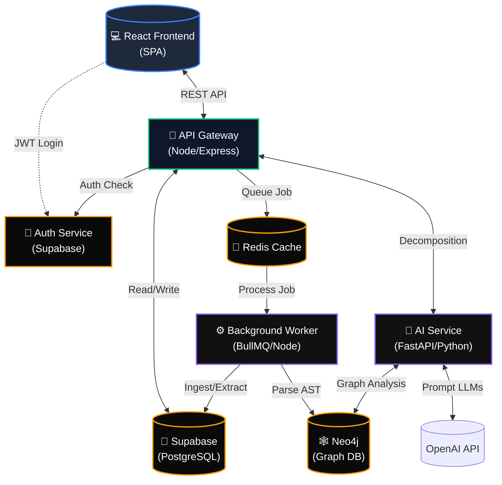

  
  <h1>MonoMELT</h1>
  
<b>Legacy Monolith to Microservices Transformation Intelligence Platform</b>

> **An AI-powered, end-to-end transformation strategy platform that ingests monolithic codebases and generates a complete, production-ready microservice blueprint.**

Modern engineering teams don't just need to "split" code—they need a cohesive, data-driven transformation strategy. Blindly decomposing a monolith leads to cascading failures, data inconsistency, and performance cliffs. **MonoMELT** solves this by taking a monolith, deeply analyzing its Abstract Syntax Tree (AST), and generating a complete transformation blueprint with risk assessments, phase-by-phase migration plans, cost projections, team structure mapping, and generated Infrastructure-as-Code.

---

## 🛠️ Technology Stack

MonoMELT is built on a modern, decoupled microservice architecture:

| Component | Tech Stack & Tools | Description |
| :--- | :--- | :--- |
| **Frontend UI** |    | A highly interactive, dark-mode composer featuring dynamic dependency graphs and multi-scenario blueprint builders. |
| **API Gateway** |   | Handles secure routing, JWT validation via Supabase, and orchestration across internal microservices. |
| **AI Engine** |    | The brain of the platform. Uses LLMs to decompose code, project costs, and generate Terraform templates. |
| **Async Worker** |   | Background job processor for heavy tasks like AST extraction, ZIP processing, and file generation. |
| **Databases** |    | Relational data is stored in Postgres (Supabase). Code dependencies and service boundaries are mapped in Neo4j. Vector embeddings are stored in Pinecone. |

---

## 🏗️ Architecture Diagram

---

## 🌟 Core Features

### 1. Zero-Touch Repository Ingestion
Upload a legacy ZIP file or point to a GitHub repository. MonoMELT's async background workers will seamlessly parse the repository structure, compute file hashes, and extract language metadata.

### 2. AI-Driven Service Decomposition
Leveraging Large Language Models and Neo4j graph algorithms, MonoMELT generates multiple tailored decomposition scenarios for the user:
- **Aggressive Split:** Maximum service distribution and scaling.
- **Conservative Split:** Fewer services to minimize initial migration friction.
- **Domain-Driven:** Strictly aligned with bounded business domains.

### 3. Visual Dependency Mapping
A fully interactive Neo4j-powered dependency graph that visually clusters source files into their newly proposed microservice boundaries, allowing users to visually inspect circular dependencies and hotspots.

### 4. Interactive Strategic Planning
Before touching any code, MonoMELT generates a comprehensive transformation roadmap, complete with:
- **Cost vs. Performance Panels:** Projected monthly infrastructure costs.
- **Team Ownership Matrix:** AI-suggested team assignments to minimize cross-team friction (Conway's Law).
- **Migration Timeline:** A phased, step-by-step Gantt chart to safely roll out the new architecture.

### 5. Instant Infrastructure-as-Code Export
Once a plan is finalized, MonoMELT dynamically generates a ZIP bundle containing:
- Boilerplate Python/FastAPI code for the new microservices.
- `docker-compose.yml` for local testing.
- `main.tf` (Terraform) files for AWS infrastructure provisioning.

### 6. Live Deployment Simulation
Provides a stunning, highly-interactive "Live Terminal" UI to simulate a complete CI/CD pipeline (Building Images, Provisioning Infrastructure, Starting Services, Health Checks), ending in a live Services Dashboard metric view.

---
*Built for the OpenAI Build Week Challenge.*