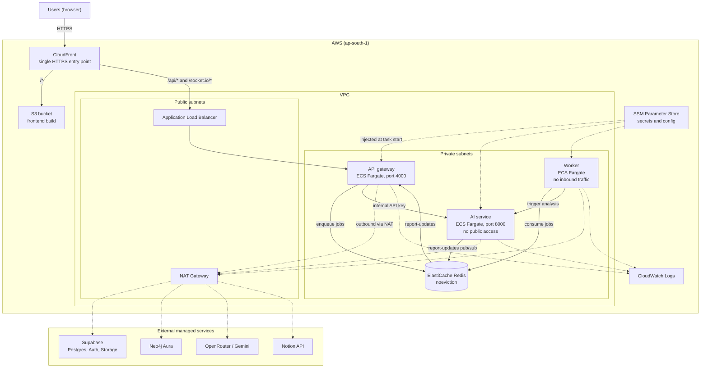
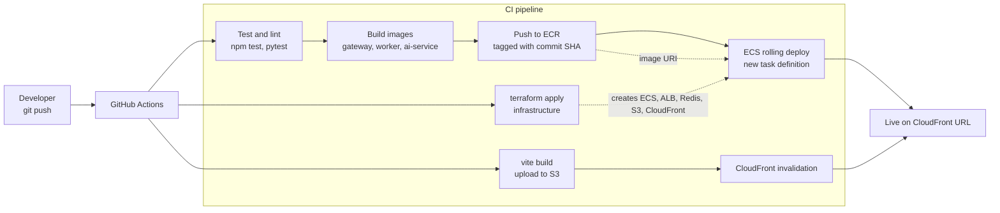

# MonoMelt Deployment

This folder describes how MonoMelt is deployed to AWS with Terraform. The design is for a small, short-lived demo: it runs for a few days and is then destroyed.

> **Status: planned.** The Terraform code, the GitHub Actions workflow and the Dockerfile fixes are not written yet. The diagrams below show the target design.

## Architecture



### Components

| Component | AWS service | Notes |
| :--- | :--- | :--- |
| Frontend | S3 + CloudFront | Static `vite build` output, served through CloudFront |
| Entry point | CloudFront | Routes `/*` to S3 and `/api`, `/socket.io` to the ALB. Gives HTTPS on the default domain and avoids CORS |
| API gateway | ECS Fargate behind the ALB | Only service with a public route. One task, so Socket.IO events reach every client |
| AI service | ECS Fargate, private | Called only by the gateway and worker |
| Worker | ECS Fargate, private | BullMQ consumer. No load balancer, no inbound traffic |
| Redis | ElastiCache | Job queue and report pub/sub. Eviction policy must be `noeviction` |
| Images | ECR | One repository per service |
| Secrets and config | SSM Parameter Store | SecureString values read by ECS at task start |
| Logs | CloudWatch Logs | One log group per service |
| Network | VPC, security groups, NAT gateway | Public subnets for the ALB and NAT. Private subnets for tasks and Redis |

Supabase, Neo4j Aura, OpenRouter, Gemini and Notion stay external. They are already managed services.

## Deployment process



### Steps

1. **Infrastructure (`terraform apply`).** Creates the VPC, ECR repositories, ALB, ECS cluster and services, ElastiCache, S3, CloudFront, IAM roles and log groups. Run once, then again when the infrastructure changes.
2. **Secrets.** Store the values from `.env` in SSM Parameter Store. Never commit them. Terraform references the parameter names, not the values.
3. **Images.** Build the gateway, worker and AI service images from their Dockerfiles. Push them to ECR with the commit SHA as the tag.
4. **Services.** Register a new ECS task definition that points at the new image, then roll the service. ECS starts the new task, waits for health checks, then stops the old one.
5. **Frontend.** Run `vite build` with `VITE_API_URL` and `VITE_WS_URL` set to the CloudFront domain (`wss://`). Upload to S3 and invalidate the CloudFront cache.
6. **Verify.** Open the CloudFront URL, sign in, upload a project and check that the report arrives over Socket.IO.

### Authentication in CI

GitHub Actions assumes an IAM role through OIDC. No long-lived AWS access keys are stored in GitHub.

## Teardown

The environment is temporary. When the demo is over:

```bash
cd deploy/terraform
terraform destroy
```

This removes the NAT gateway, ALB, ElastiCache node and Fargate tasks, which are the main ongoing costs. Supabase and Neo4j Aura are not affected.

## Before first deploy

- Change the gateway Dockerfile `CMD` from `npm run dev` to `npm start`.
- Set `FRONTEND_URL`, `ALLOWED_ORIGINS` and `AI_SERVICE_URL` for the deployed hosts.
- Use the same `INTERNAL_API_KEY` in the gateway and AI service.
- Add the CloudFront URL to the Supabase Auth redirect list.
- Set the Redis parameter group to `noeviction`.
