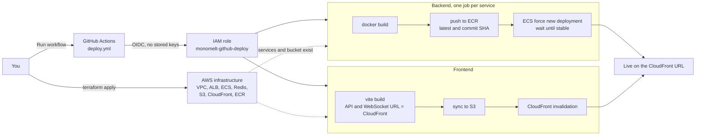

# MonoMelt Deployment

MonoMelt is deployed to AWS (`ap-south-1`) with Terraform. The design is for a small, short-lived demo: it runs for a few days and is then destroyed.

- **Infrastructure** is created from [`terraform/`](terraform) with `terraform apply`, run from your machine.
- **Application** (container images and the frontend build) is deployed by the manual GitHub Actions workflow [`deploy.yml`](../.github/workflows/deploy.yml).

## Architecture


### Components

| Component | AWS service | Notes |
| :--- | :--- | :--- |
| Frontend | S3 + CloudFront | Static `vite build` output. Client-side routes are rewritten to `index.html` by a CloudFront Function |
| Entry point | CloudFront | `/*` goes to S3. `/api/*`, `/api-docs*`, `/health` and `/socket.io/*` go to the ALB, uncached, with all headers forwarded. HTTPS on the default `*.cloudfront.net` domain, and no CORS because everything shares one origin |
| Load balancer | Application Load Balancer | Accepts traffic only from CloudFront (managed prefix list) and only with a secret header CloudFront adds. Anything else gets a 403 |
| API gateway | ECS Fargate | One task, so Socket.IO events reach every client. The only service behind the ALB |
| AI service | ECS Fargate, private | Reached by name (`ai-service.monomelt.local`) through Cloud Map DNS, only from the gateway and worker |
| Worker | ECS Fargate, private | BullMQ consumer. No load balancer, no inbound traffic |
| Redis | ElastiCache, `cache.t4g.micro` | Job queue and report pub/sub. Eviction policy is `noeviction`, which BullMQ requires. No TLS, so every service uses `redis://` |
| Images | ECR | One repository per service, keeping the last 5 images |
| Secrets | SSM Parameter Store | 12 SecureString parameters under `/monomelt/`, injected into the containers at start |
| Logs | CloudWatch Logs | One log group per service, 7 days retention |
| Network | VPC, security groups, one NAT gateway | Public subnets for the ALB and NAT, private subnets for tasks and Redis |

Supabase, Neo4j Aura, OpenRouter, Gemini and Notion stay external. They are already managed services.

The task definitions get `FRONTEND_URL`, `ALLOWED_ORIGINS`, `AI_SERVICE_URL` and `REDIS_URL` straight from Terraform, so no URL has to be edited by hand after the deploy.

## Deployment process



## Prerequisites (done once)

| What | Where |
| :--- | :--- |
| AWS CLI profile `monomelt` | `aws configure --profile monomelt` |
| GitHub OIDC provider and the role `monomelt-github-deploy` | IAM |
| 12 SecureString parameters under `/monomelt/` | SSM Parameter Store, `ap-south-1` |
| Repository variables `AWS_DEPLOY_ROLE_ARN` and `AWS_REGION` | GitHub > Settings > Secrets and variables > Actions > Variables |
| Repository variables `VITE_SUPABASE_URL` and `VITE_SUPABASE_ANON_KEY` | Same page. Both values are public, they are baked into the frontend build |

The 12 parameters: `database-url`, `gemini-api-key`, `internal-api-key`, `neo4j-password`, `neo4j-uri`, `neo4j-username`, `notion-api-key`, `notion-database-id`, `openrouter-api-key`, `supabase-jwt-secret`, `supabase-service-role-key`, `supabase-url`.

## Deploy

1. **Create the infrastructure.**

   ```bash
   export AWS_PROFILE=monomelt
   cd deploy/terraform
   terraform init
   terraform plan
   terraform apply
   ```

   It takes about 10 minutes, most of it CloudFront and ElastiCache. The ECS services start without images, so their tasks fail to pull until the next step. That is expected.

2. **Run the workflow.** GitHub only lists a `workflow_dispatch` workflow once the file is on the default branch, so merge `deploy.yml` into `main` first. Then open **Actions > Deploy > Run workflow**. It builds the three images, pushes them to ECR, rolls each ECS service and waits until it is stable, then builds the frontend against the CloudFront domain and uploads it to S3.

3. **Allow the login redirect.** Take `supabase_redirect_url` from `terraform output` and add it to Supabase > Authentication > URL Configuration > Redirect URLs. Set the Site URL to `frontend_url` as well.

4. **Verify.**
   - `<frontend_url>/health` returns `status: up` and shows `ai-service`, `neo4j`, `postgres` and `redis` as connected.
   - The login page loads and GitHub sign-in returns to the app.
   - Upload a small project, run the analysis, and check that the report appears over the socket.
   - CloudWatch log groups `/ecs/monomelt/<service>` show no errors.

Updating the app later means running the workflow again. Infrastructure changes mean `terraform apply` again.

## Debugging

- **A service keeps restarting:** open its log group in CloudWatch, or check **ECS > Clusters > monomelt > Services > Tasks > Stopped** for the stop reason.
- **Tasks cannot read a secret:** the SSM parameter name must match exactly, in `ap-south-1`.
- **AI service cannot reach Neo4j:** check that the Aura instance accepts connections from the internet. The tasks leave through the NAT gateway's Elastic IP, which `terraform output` does not print but the EC2 console lists.
- **Shell into a container:** `aws ecs execute-command --cluster monomelt --task <id> --container <name> --interactive --command sh`, which needs the Session Manager plugin installed locally.

## Teardown

The environment is temporary. When the demo is over:

```bash
export AWS_PROFILE=monomelt
cd deploy/terraform
terraform destroy
```

This removes everything Terraform created: the NAT gateway, ALB, ElastiCache node, Fargate tasks and CloudFront distribution, which are the main ongoing costs. The ECR repositories and the S3 bucket are deleted even if they still hold images or files. The SSM parameters, the IAM user, the OIDC provider and the deploy role were created by hand and stay in place. Supabase and Neo4j Aura are not affected.

## Cost

Rough fixed cost while it runs, in `ap-south-1`: one NAT gateway, one ALB, one `cache.t4g.micro` node and three small Fargate tasks. Over a 3 to 4 day demo that is about $10 to $20. Check the AWS Pricing Calculator for exact figures, and run `terraform destroy` as soon as the demo is done.

## Files

| File | Purpose |
| :--- | :--- |
| `terraform/versions.tf` | Terraform and provider versions, AWS provider |
| `terraform/variables.tf` | Region, project name, Redis size, task count, Neo4j database |
| `terraform/locals.tf` | Names, SSM parameter ARNs, wiring between resources |
| `terraform/network.tf` | VPC, subnets, internet gateway, NAT gateway, route tables |
| `terraform/security.tf` | Security groups and their rules |
| `terraform/ecr.tf` | Image repositories and lifecycle policy |
| `terraform/redis.tf` | ElastiCache Redis, parameter group with `noeviction` |
| `terraform/iam.tf` | ECS task execution role and task role |
| `terraform/alb.tf` | Load balancer, target group, listener and the CloudFront-only rule |
| `terraform/ecs.tf` | Cluster, log groups, Cloud Map, task definitions and services |
| `terraform/frontend.tf` | S3 bucket and the CloudFront distribution |
| `terraform/outputs.tf` | Frontend URL, Supabase redirect URL, resource names |
