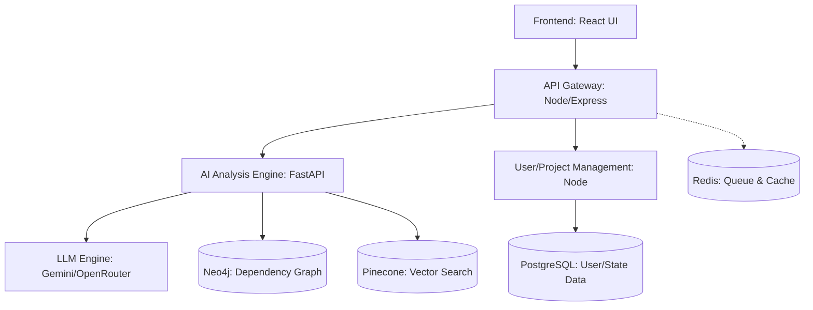

# Technical Requirements Document (TRD)
## Legacy Monolith to Microservices Transformation Intelligence Platform

---

### 1. System Overview
The platform will utilize a modern microservices architecture for its internal operations, ensuring scalability, robust data handling, and clean integration with AI/LLM models. The system encompasses a frontend UI, an API Gateway/Orchestrator, a core AI Analysis engine, and multiple database layers optimized for specific data types (graph, relational, and vector).

### 2. Architecture Diagram (Conceptual)

### 3. Technology Stack Requirements

**3.1. Frontend**
- **Framework:** React.js
- **Visualization:** D3.js or react-force-graph for rendering Neo4j interactive dependency graphs.
- **State Management:** Redux or Zustand.
- **Styling:** Vanilla CSS / Tailwind (if preferred) ensuring high-quality, premium aesthetic (glassmorphism, modern typography).

**3.2. API Gateway & Orchestration**
- **Framework:** Node.js with Express.
- **Responsibilities:** Request routing, rate limiting, authentication/authorization, session management.

**3.3. Core AI Analysis Service**
- **Framework:** FastAPI (Python).
- **Responsibilities:** Code parsing (AST generation), communicating with LLMs (Gemini/OpenRouter), structuring prompt responses, interacting with Neo4j and Pinecone.

**3.4. Data Storage**
- **Relational DB:** PostgreSQL for structured data (Users, Projects, Final Generated Blueprints, Decision Audit Trails).
- **Graph DB:** Neo4j for mapping complex dependencies (Functions -> Classes -> Services -> Teams) and performing graph algorithms (clustering, risk scoring).
- **Vector DB:** Pinecone for similarity search (comparing monolith patterns to known microservice patterns).
- **Cache/Queue:** Redis and/or RabbitMQ for managing heavy asynchronous analysis tasks (e.g., waiting for LLM responses).

### 4. API & Integration Specifications

**4.1. LLM Integration**
- **Provider:** Gemini or OpenRouter APIs.
- **Format:** Strict JSON responses forced via prompt engineering or function calling to ensure parseable blueprint generation.

**4.2. Internal APIs (REST / GraphQL)**
- `POST /api/upload`: Handles zip/repo ingestion, enqueues analysis task.
- `GET /api/projects/{id}/graph`: Returns graph nodes/edges for the React frontend.
- `POST /api/projects/{id}/strategy`: Accepts user choice of strategy (e.g., "Aggressive") and triggers LLM generation.
- `GET /api/projects/{id}/export`: Generates the zipped blueprint (Kubernetes, OpenAPI, Markdown reports).

### 5. Infrastructure & Deployment
- **Containerization:** All services (React, Node, FastAPI) must be Dockerized.
- **Orchestration:** Kubernetes (or Docker Compose for local/hackathon dev).
- **CI/CD:** GitHub Actions for basic linting, testing, and deployment.

### 6. Security & Performance
- **Security:** 
  - JWT-based authentication for user sessions.
  - LLM API keys injected via secure environment variables (`.env`).
  - Strict input validation on uploaded zip files (sanitize against malicious scripts/bombs).
- **Performance:** 
  - Graph rendering in the UI must be optimized (e.g., collapsing nodes) if the codebase has >10,000 entities.
  - LLM requests must be processed asynchronously to prevent HTTP timeout errors on the Gateway.
